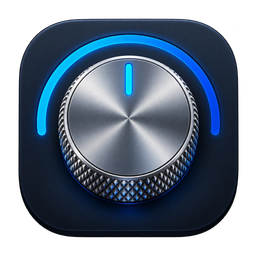
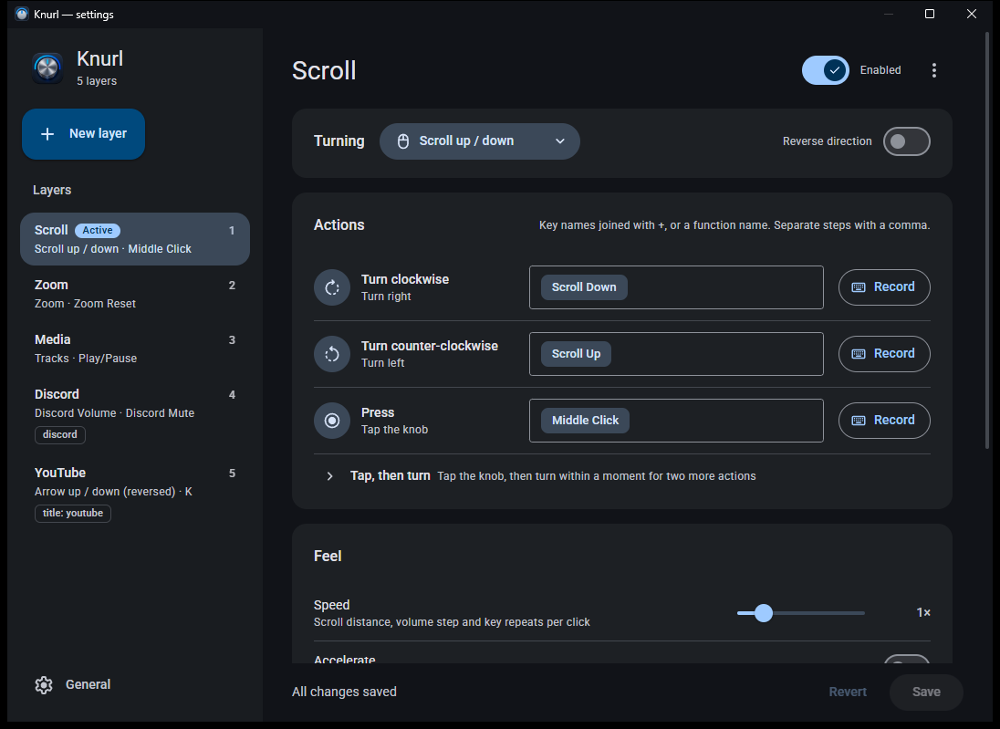
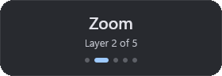
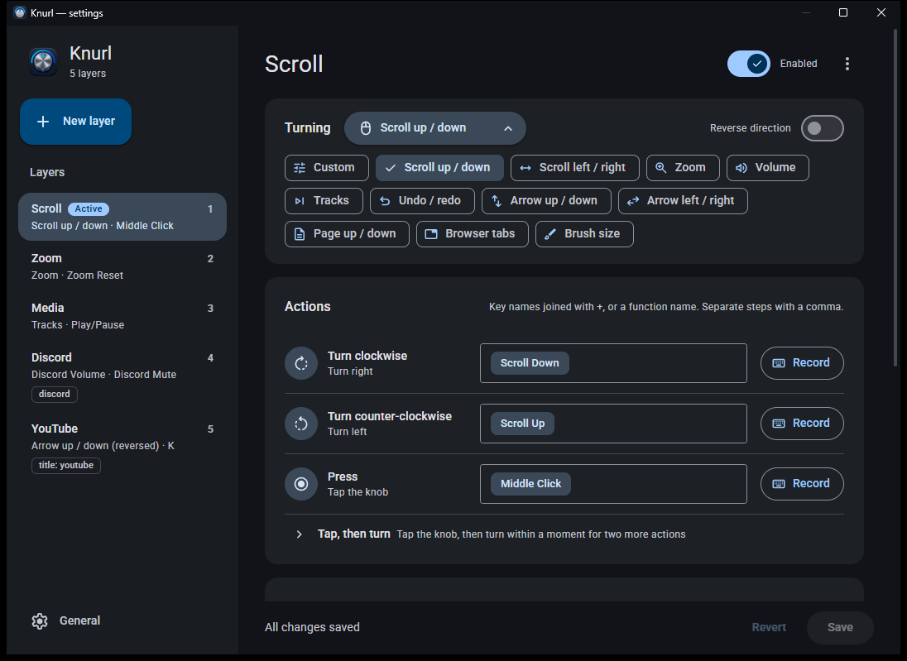
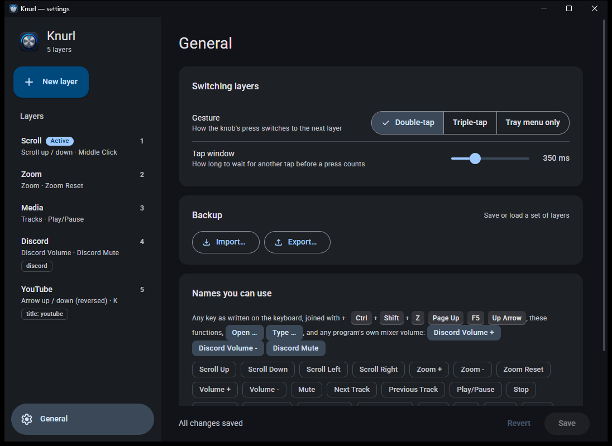
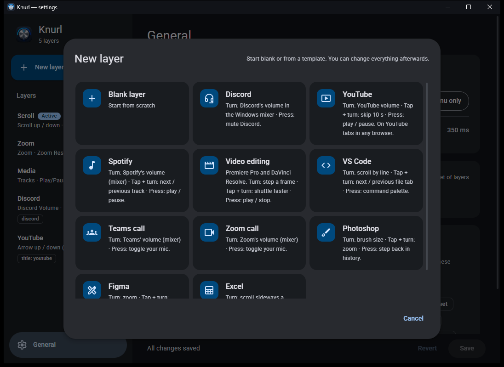
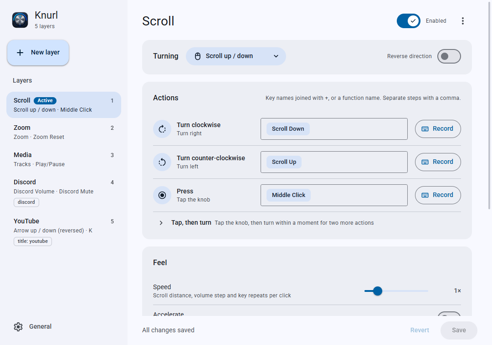

<p align="center"></p>

<h1 align="center">Knurl</h1>

<p align="center">Turn a cheap USB / Bluetooth rotary knob into a layered controller for Windows.</p>

<p align="center"></p>

Knurl is a small tray app for Windows 10 and 11. Turning and pressing the knob runs actions you choose:
scrolling, zoom, media keys, keyboard shortcuts, or one program's own volume in the Windows mixer.
Actions are grouped into **layers**. Double-tap the knob to switch layers, or let Knurl switch for you when
you focus a particular app or browser tab.

It was built for the **ANTICATER VK-01** desk knob, but works with any knob that can be set to send
**F13 / F14 / F15**.

## Features

- **Layers** of actions for turn clockwise, turn counter-clockwise and press, plus two more for
  *tap, then turn*.
- **Switch layers** by double-tap, triple-tap or the tray menu, with a small popup showing where you are.
- **Per-app layers**: a layer can follow the focused program (`chrome`, `code`) or a window title
  (`title:YouTube`), so the knob does the right thing in each app.
- **Actions you can read**: key names (`Ctrl + Shift + Z`), short function names (`Scroll Down`, `Zoom +`,
  `Play/Pause`), `Open …`, `Type …`, steps separated by commas. Checked as you type, with suggestions,
  or record a shortcut straight from the keyboard.
- **Per-program volume**: `Discord Volume +`, `Spotify Mute` and so on change that program's volume in the
  Windows mixer, not the system volume (handy with an external DAC).
- **Templates** for Discord, YouTube, Spotify, video editing, VS Code, Teams, Zoom, Photoshop, Figma and Excel.
- **Feel**: speed, acceleration for fast spins, and a rate limit per layer.
- Knob setup from the tray, battery warnings over Bluetooth, start with Windows, light and dark themes.

<p align="center"></p>

## Screenshots

| | |
|---|---|
|  |  |
| *Pick what turning does, or type your own actions* | *Gesture, tap timing, backup and the names you can use* |
|  |  |
| *Start a layer from a template* | *Follows the Windows light / dark setting* |

## Getting started

1. **Build** (needs [Rust](https://rustup.rs) and the Windows SDK, which comes with Visual Studio Build Tools):
   ```
   cd knurl
   cargo build --release
   ```
2. **Run** `knurl\target\release\knurl.exe`. Knurl lives in the tray; right-click it for the menu.
3. **Set up the knob**: with the VK-01 plugged in over USB, choose *Set up knob* in the tray menu. This maps
   its turns and press to F13 / F15 / F14. The mapping is stored on the knob itself.
   Other knobs: map them to F13 (counter-clockwise), F14 (press) and F15 (clockwise) with their own software.
4. Optional: *Install to this PC* copies Knurl to `%LOCALAPPDATA%\Programs\Knurl` with a Start-menu entry,
   and *Start with Windows* launches it at sign-in.

Settings open from the tray (or by launching Knurl again). They're saved to `%APPDATA%\Knurl\config.json`;
editing that file by hand works too, and Knurl reloads it on the fly.

Needs the Microsoft Edge WebView2 runtime for the settings window (included with Windows 11).

## How it works

The knob reports F13–F15 instead of volume keys, so nothing else on the PC reacts to it. Knurl registers those
keys as hotkeys, turns taps and turns into gestures, and sends the current layer's action with `SendInput` or
the Windows audio session API. The tray and popup are native Win32 (the popup is drawn with Direct2D); the
settings window is a single HTML page in WebView2, only loaded while it's open.

```
knurl/src/    main.rs  app, tray, hotkeys      knob.rs   gestures       action.rs  sending input
              names.rs action names            config.rs settings       apps.rs    per-app layers
              audio.rs per-app volume          system.rs install, knob  popup.rs   layer popup
              theme.rs dark mode               webui.rs  settings window
knurl/ui/     settings.html (+ generated icons.js, assets.css)
```

`cargo test` runs the unit tests.

## Credits

- Icons: [Material Symbols](https://fonts.google.com/icons) by Google, Apache License 2.0.
- Font: [Roboto](https://fonts.google.com/specimen/Roboto) by Google, SIL Open Font License 1.1.
- Built with [native-windows-gui](https://github.com/gabdube/native-windows-gui),
  [wry](https://github.com/tauri-apps/wry), [hidapi](https://github.com/ruabmbua/hidapi-rs) and the
  [windows](https://github.com/microsoft/windows-rs) crates.
